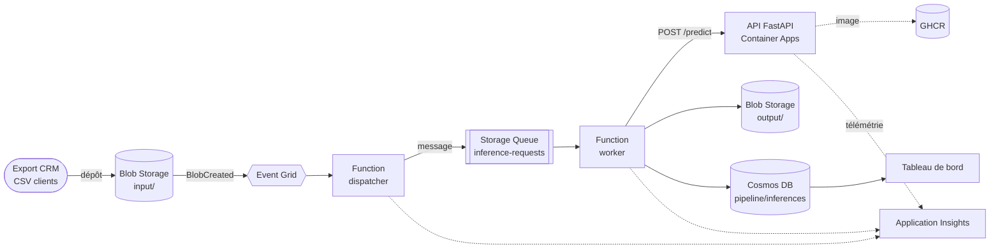

# Telecom Churn Cloud : pipeline ML événementiel sur Azure

Projet de synthèse ECE Paris, module « Systèmes distribués et IA » (2026-2027).

Un fichier CSV de clients télécom déposé dans Blob Storage (`input/`) est validé, mis en file d'attente,
envoyé à une API de Machine Learning (FastAPI sur Azure Container Apps) qui prédit le risque de désabonnement
de chaque client ; les résultats sont stockés (Blob `output/` + Cosmos DB) et affichés dans un tableau de bord.

## Équipe

| Membre | Rôle | Dossiers |
|---|---|---|
| Membre 1 | Machine Learning | `/model` |
| Membre 2 | API, Docker, compte Azure, coûts | `/api`, `/infra` |
| Membre 3 | Pipeline événementiel (Functions) | `/functions` |
| Membre 4 | Dashboard, CI/CD, supervision, documentation | `/web`, `/.github/workflows`, `/docs` |

Les formats échangés entre les parties sont dans [`docs/contrats.md`](docs/contrats.md).

## Structure

```
/model               train.py, churn_model.py (fonction de prédiction), tests, requirements.txt
/api                 FastAPI, Dockerfile multi-étapes, tests
/functions           function_app.py (dispatcher, worker, recent), host.json
/web                 tableau de bord statique
/infra               script az commenté (Bicep en bonus)
/docs                contrats, schéma, captures, rapport de coûts, journal de temps
/.github/workflows   ci.yml, deploy.yml
```

## 1. Jeu de données et modèle (membre 1)

- **Jeu de données** : IBM Telco Customer Churn, dépôt [IBM/telco-customer-churn-on-icp4d](https://github.com/IBM/telco-customer-churn-on-icp4d), licence Apache-2.0. Environ 7 000 clients, 21 colonnes, moins de 1 Mo.
- **Tâche** : classification binaire, le client part-il (`Churn = Yes`) ?
- **Préparation** : `TotalCharges` converti en nombre (valeurs vides imputées par la médiane), numériques normalisées, catégorielles en one-hot, le tout dans un seul `Pipeline` scikit-learn exporté.
- **Protocole** : jeu de test stratifié de 20 %, graine 42, versions figées dans `model/requirements.txt` (Python 3.12, numpy 2.5.3, pandas 3.0.5, scikit-learn 1.9.1, joblib 1.6.0).
- **Fichiers produits** (versionnés dans le dépôt) : `model/artifacts/model-1.0.0.joblib`, `metrics-1.0.0.json`, `sample-clients.csv` (fichier de démo pour le pipeline) et une copie du modèle dans `api/models/`. L'API doit installer les mêmes versions de numpy, pandas, scikit-learn et joblib, sinon le modèle ne se charge pas.
- **Modèles** : régression logistique et Random Forest (`class_weight="balanced"`), comparés à une référence naïve qui prédit toujours « ne part pas ». Le meilleur en ROC-AUC devient `model-1.0.0.joblib`.

Reproduire :

```bash
cd model
pip install -r requirements.txt
python train.py        # télécharge les données, entraîne, écrit artifacts/
pytest -q tests
```

Résultats sur le jeu de test (1 409 clients, 26,5 % de churn ; détail dans `model/artifacts/metrics-1.0.0.json`) :

| Modèle | ROC-AUC | F1 churn | Précision | Rappel | Accuracy |
|---|---|---|---|---|---|
| Référence naïve (toujours « Non ») | 0,500 | 0,000 | 0,000 | 0,000 | 0,735 |
| **Régression logistique (v1.0.0)** | **0,841** | 0,614 | 0,504 | 0,783 | 0,738 |
| Random Forest | 0,840 | 0,632 | 0,535 | 0,773 | 0,761 |

L'accuracy seule est trompeuse : la référence naïve obtient 73,5 % d'accuracy sans détecter un seul départ (F1 = 0).
Les deux modèles détectent environ 78 % des clients qui partent (rappel). La régression logistique est retenue :
meilleure ROC-AUC (à égalité ou presque avec la Random Forest), plus légère et ses coefficients sont explicables.

Version retenue : `model-1.0.0.joblib`, environ 3 Ko (limite : 100 Mo), 16 ms pour prédire un lot de 1 000 clients sur CPU (limite : 1 s).

## 2. Architecture et région (membre 2)

Schéma détaillé, parcours d'un fichier et responsables de chaque composant : [`docs/architecture.md`](docs/architecture.md).



1. Un CSV de clients (1 à 1 000 lignes) est déposé dans le conteneur `input/` du compte de stockage.
2. Event Grid publie l'événement `BlobCreated` ; la Function *dispatcher* valide le fichier et met un message
   dans la file `inference-requests` (format : `docs/contrats.md`, section 3).
3. La Function *worker* lit le CSV et l'envoie en un seul appel à `POST /predict` de l'API.
4. Les prédictions par client vont dans `output/`, le résumé du fichier dans Cosmos DB, que lit le tableau de bord.
5. L'API, les Functions et la CI remontent leur télémétrie dans Application Insights.

La file découple la réception de l'inférence : si l'API redémarre (démarrage à froid avec `min-replicas 0`),
les messages attendent et sont retraités au lieu d'être perdus.

**Région : France Central (`francecentral`).** Justification :

- **Autorisée par la souscription** : la stratégie Azure for Students « Allowed resource deployment regions »
  n'accepte que `francecentral`, `germanywestcentral`, `italynorth`, `norwayeast` et `denmarkeast`.
- **Tous les services du projet y sont disponibles** : Container Apps, Functions, Storage, Event Grid,
  Cosmos DB et Application Insights (vérifié avec `az provider show`). `denmarkeast` n'a pas Container Apps.
- **Latence la plus faible depuis Paris**, pour le dépôt des fichiers et la démonstration.
- **Données dans l'Union européenne, en France** (RGPD) : les fichiers CRM contiennent des données de clients.
- **Une seule région pour toutes les ressources** : pas de trafic sortant facturé entre régions et une
  latence minimale entre le worker et l'API.

## 3. API d'inférence (membre 2)

API FastAPI dans `api/` (détails, contrat complet et configuration : [`api/README.md`](api/README.md)).
Image Docker multi-étapes `python:3.12-slim`, utilisateur non root, environ 123 Mo compressée, publiée sur
`ghcr.io/mkh-dev/telecom-churn-cloud/api` et déployée sur Azure Container Apps (0,25 vCPU, 0,5 Gi, 0 à 2 réplicas).

| Endpoint | Rôle |
|---|---|
| `POST /predict` | Prédit le churn de 1 à 1 000 clients (422 si l'entrée est invalide) |
| `GET /health` | État du modèle ; 503 s'il n'est pas chargé (sondes liveness et readiness) |
| `GET /version` | Versions de l'API et du modèle |
| `GET /metrics` | Appels, latence moyenne, clients scorés, erreurs |

Exemple (en local : `URL=http://localhost:8000`) :

```bash
curl -s -X POST $URL/predict -H 'Content-Type: application/json' -d @api/dev/sample_request.json
```

```json
{
  "predictions": [
    {"customerID": "7590-VHVEG", "churn_probability": 0.8021, "churn": true, "churn_prediction": 1, "risk_level": "élevé"},
    {"customerID": "5575-GNVDE", "churn_probability": 0.119, "churn": false, "churn_prediction": 0, "risk_level": "faible"}
  ],
  "model_version": "1.0.0",
  "latency_ms": 10.7
}
```

Le modèle est choisi par la variable `MODEL_PATH` : `model-1.0.0.joblib` (régression logistique) par défaut,
`model-2.0.0.joblib` (Random Forest) pour une seconde révision en A/B, sans changer le code. Latence mesurée
pour 1 000 clients : 8 ms (1.0.0) et 35 ms (2.0.0).

## 4. Pipeline événementiel (membre 3)

Documentation complète : [`docs/pipeline.md`](docs/pipeline.md). Code : `functions/`. Scripts Azure : `infra/pipeline/`.

Une seule Function App Flex Consumption (Python 3.12) contient trois fonctions :

| Fonction | Déclencheur | Rôle |
|---|---|---|
| `dispatcher` | Event Grid `BlobCreated` filtré sur `input/` | Vérifie l'extension, la taille, l'UTF-8, les 20 colonnes, les types et les 1 000 lignes maximum. Pose un ticket dans `inference-requests`, ou copie le fichier dans `rejected/` avec le motif |
| `worker` | File `inference-requests` | Appelle `POST /predict` (un appel par fichier, délai de 20 s, client HTTP réutilisé). Écrit `output/<nom>_<etag>.json` et fait un upsert dans Cosmos DB (idempotent) |
| `recent` | HTTP `GET /api/recent` | Renvoie les 20 dernières inférences pour le tableau de bord (CORS limité au site) |

En cas d'échec, `host.json` fixe `maxDequeueCount = 5` avec une visibilité de 10 s. Le message part ensuite dans `inference-requests-poison` ; le scénario « API coupée » est documenté dans `docs/pipeline.md` §5.

Les connexions passent par l'identité managée, sans aucun secret.

Exemple d'événement Event Grid (extrait de [`docs/exemples-pipeline/evenement_eventgrid.json`](docs/exemples-pipeline/evenement_eventgrid.json)) :

```json
{"subject": "/blobServices/default/containers/input/blobs/clients-2026-11-25.csv",
 "eventType": "Microsoft.Storage.BlobCreated", "eventTime": "2026-11-25T10:42:07.1234567Z",
 "data": {"api": "PutBlob", "eTag": "0x8DD0A1B2C3D4E5F", "contentLength": 4123,
          "url": "https://st<equipe>pipe.blob.core.windows.net/input/clients-2026-11-25.csv"}}
```

Message de file correspondant :

```json
{"blobName": "input/clients-2026-11-25.csv", "etag": "0x8DD0A1B2C3D4E5F", "size": 4123, "rows": 20, "timestamp": "2026-11-25T10:42:07Z"}
```

Tester en local, sans Azure :

```bash
pip install -r model/requirements.txt && ruff check . && pytest functions/tests
```

## 5. Tableau de bord (membre 4)

Page statique `web/` (HTML, CSS, JavaScript, [Chart.js 4.4.1](https://www.chartjs.org/)), sans framework ni build,
hébergée dans le **site web statique** du compte de stockage (`$web`). Elle lit `GET /api/recent`
(contrat : [`docs/contrats.md`](docs/contrats.md), section 5) toutes les 30 s.

| Élément | Contenu |
|---|---|
| Indicateurs | fichiers traités (et en erreur), clients scorés, clients à risque élevé, taux de churn prédit (moyenne pondérée), durée moyenne de traitement, version du modèle |
| Graphiques | taux de churn par fichier, répartition des niveaux de risque, clients par fichier (risque élevé / autres), durée de traitement comparée à l'objectif de 2 s |
| Tableaux | derniers fichiers (documents Cosmos DB, statut `ok` / `error`) ; clients du dernier fichier triés par probabilité, filtrables par risque, recherche par `customerID`, export CSV |
| Robustesse | mode démo sans API (`demo/recent.json`, données fictives) ; si l'API ne répond pas, bandeau d'erreur et données de démo ; thème clair/sombre ; affichage mobile |

Lancer en local :

```bash
cd web
python -m http.server 8080
# http://localhost:8080/?demo=1                                  données fictives
# http://localhost:8080/?api=https://<function-app>.azurewebsites.net   vraies données
```

En production, `deploy.yml` réécrit `web/config.js` avec l'adresse de la Function App. Avec la vraie réponse de
`/api/recent`, le tableau des clients affiche les 5 clients les plus à risque du dernier fichier (`topRisk`).

## 6. Intégration et déploiement continus (membre 4)

| Workflow | Déclencheur | Ce qu'il fait |
|---|---|---|
| [`ci.yml`](.github/workflows/ci.yml) | push sur `main`, toute pull request | **model**, **functions** : ruff + pytest ; **api** : ruff + pytest + image Docker, publiée sur GHCR (`<version>` et `sha-<commit>`) seulement sur `main` ; **web** : syntaxe JS, données de démo conformes au contrat, validation HTML |
| [`deploy.yml`](.github/workflows/deploy.yml) | après chaque run **vert** de `CI` sur `main`, ou à la main | connexion **OIDC** ; **api** : nouvelle révision Container Apps avec l'image `sha-<commit>`, puis vérification que `GET /version` renvoie ce commit ; **functions** : déploiement Flex Consumption puis vérification de `/api/recent` ; **web** : `config.js` de production et envoi dans `$web` |

**Aucun secret dans GitHub.** `deploy.yml` s'authentifie par **OIDC** (identité fédérée) : GitHub fournit un jeton
signé à courte durée de vie ; Azure ne l'accepte que s'il vient de ce dépôt et de l'environnement `production`,
et délivre en échange un jeton d'accès de quelques minutes pour l'**identité managée** `id-github-<equipe>`.
Cette identité n'a que deux rôles, limités au projet : *Contributor* sur le groupe de ressources et
*Storage Blob Data Contributor* sur le compte de stockage. Les Functions accèdent au stockage et à Cosmos DB avec
leur propre identité managée (membre 3) : aucune chaîne de connexion nulle part.

Variables du dépôt (*Settings > Secrets and variables > Actions > Variables*, ce ne sont pas des secrets),
affichées par [`infra/github-oidc.sh`](infra/github-oidc.sh) :

| Variable | Exemple |
|---|---|
| `AZURE_CLIENT_ID`, `AZURE_TENANT_ID`, `AZURE_SUBSCRIPTION_ID` | identifiants publics de l'identité managée |
| `AZURE_RG`, `API_APP`, `FUNC_APP`, `STORAGE_ACCOUNT` | `rg-projet-<equipe>`, `api-<equipe>`, `func-<equipe>`, `st<equipe>pipe` |

Si une variable manque, `deploy.yml` **échoue** avec un message explicite au lieu de « réussir » sans rien déployer.

Preuve qu'un commit sur `main` met à jour l'API : la CI fige le SHA court dans l'image (`--build-arg GIT_SHA`),
et le job **api** attend que `GET /version` le renvoie :

```bash
curl -s https://api-<equipe>.<region>.azurecontainerapps.io/version
# {"api_version":"0.2.0","model_version":"1.0.0","commit":"3f9c2ab"}
```

## 7. Supervision et alertes (membre 4)

[`infra/monitoring.sh`](infra/monitoring.sh) crée Log Analytics (rétention 30 jours, **plafond 0,1 Go/jour** pour le
budget) et Application Insights `appi-<equipe>`. Il les branche sur la Function App et la Container App, et crée
un groupe d'actions e-mail et 5 alertes :

| Alerte | Condition | Sévérité |
|---|---|---|
| `alert-fichier-rejete` | trace `DISPATCH_REJECTED` : un fichier déposé a été rejeté | 3 |
| `alert-echec-worker` | trace `WORKER_FAILED` : le worker a échoué (nouvelle tentative ou poison) | 2 |
| `alert-erreurs-5xx` | plus de 3 requêtes en échec en 5 min | 2 |
| `alert-latence` | temps de réponse moyen > 2 000 ms sur 15 min (critère de succès < 2 s) | 3 |
| `alert-file-en-attente` | plus de 20 messages en attente dans les files | 3 |

**Métriques personnalisées** (OpenTelemetry, table `customMetrics`) : `pipeline.inferences` (nombre
d'inférences) et `pipeline.model_latency_ms` (latence du modèle) envoyées par le worker, ainsi que
`churn_customers_scored` et `churn_model_latency_ms` envoyées par l'API.

**Alerte déclenchée volontairement** : [`infra/declencher-alerte.sh`](infra/declencher-alerte.sh) dépose un CSV
sans les colonnes obligatoires. Le dispatcher le rejette, puis `alert-fichier-rejete` se déclenche en 5 à 10 min
et envoie l'e-mail. Le script attend l'alerte dans Azure Monitor et affiche son état. Capture :
`docs/captures/10-alertes.png`.

### Requêtes KQL

Dans [`docs/kql/requetes.kql`](docs/kql/requetes.kql) (portail > Application Insights > *Journaux*) :

1. **Nombre d'inférences par heure** : `customMetrics` `pipeline.inferences` (fichiers) et
   `pipeline.customers_scored` (clients), regroupés par heure.
2. **Les 5 fichiers les plus lents** : traces `INFERENCE_DONE` du worker, triées par `durationMs`, avec la
   latence de l'API et du modèle, et le nombre de clients.
3. **Répartition des codes HTTP et des erreurs** : `requests` par composant et `resultCode`, plus les erreurs
   du pipeline par type (`reasonCode` des rejets, `errorType` des échecs du worker).

Bonus : latence du modèle par version (A/B 1.0.0 / 2.0.0). Captures : [`docs/captures/`](docs/captures/).

## 8. Déploiement pas à pas

Toutes les commandes sont lancées depuis la racine du dépôt, dans Bash (Cloud Shell, WSL ou Git Bash), après
`az login`, par le propriétaire de l'abonnement d'intégration. Les noms communs sont dans
`infra/pipeline/env.sh` (renseigner `EQ` et `LOC`).

```bash
source infra/pipeline/env.sh

# 1. Supervision d'abord : la Function App sera créée avec Application Insights (membre 4)
ALERT_EMAIL=<adresse> bash infra/monitoring.sh

# 2. Socle du pipeline : Cosmos DB, stockage (+ $web), file, Function App, identité, CORS (membre 3)
bash infra/pipeline/01_pipeline.sh

# 3. API sur Container Apps (membre 2) : voir api/deploy/containerapp.md
#    (image ghcr.io/mkh-dev/telecom-churn-cloud/api, 0,25 vCPU, 0 à 2 réplicas, port 8000)

# 4. Identité managée + OIDC pour GitHub Actions (membre 4), puis créer les variables affichées
bash infra/github-oidc.sh

# 5. Premier déploiement : GitHub > Actions > Deploy > Run workflow (API + Functions + tableau de bord)

# 6. Relancer 01 (API_URL pointe alors vers l'API) et 02 (abonnement Event Grid après le code)
bash infra/pipeline/01_pipeline.sh && bash infra/pipeline/02_eventgrid.sh

# 7. Relancer la supervision pour brancher la Container App et créer les alertes sur le stockage
ALERT_EMAIL=<adresse> bash infra/monitoring.sh

# 8. Démonstration et preuves
bash infra/pipeline/03_demo.sh valide
bash infra/declencher-alerte.sh
```

Ensuite, chaque fusion sur `main` lance `CI` puis `Deploy` automatiquement.
Après la soutenance : `az group delete -n "$RG" --yes` (budget).

## 9. Restrictions Azure for Students rencontrées et solutions

| Restriction | Conséquence | Solution appliquée |
|---|---|---|
| Stratégie « Allowed resource deployment regions » : 5 régions seulement | `denmarkeast` n'a pas Container Apps | Une seule région pour tout le projet (section 2) |
| Création d'une application Entra ID / principal de service souvent refusée aux comptes étudiants (`az ad sp create-for-rbac` : privilèges insuffisants) | Impossible d'utiliser un principal de service pour OIDC | **Identité managée attribuée par l'utilisateur** avec identifiants fédérés GitHub (`infra/github-oidc.sh`) : OIDC sans application Entra ID et sans secret |
| Cosmos DB : le portail ne propose que des régions EUAP | – | Création en CLI (`01_pipeline.sh`, étape 1) |
| Création de la Function App limitée (`429 throttled`) | Échec ponctuel | Attendre, puis relancer le script (ré-exécutable) |
| Le propriétaire n'a pas de rôle de données sur le stockage (`AuthorizationPermissionMismatch`) | `az storage … --auth-mode login` refusé | Rôles de données attribués aux identités (Function App, GitHub) ; clé lue par ARM seulement dans le script d'installation |
| Budget limité (crédit étudiant, 25 $ visés) | Coûts de télémétrie possibles | Plafond Log Analytics 0,1 Go/jour, rétention 30 jours, Container Apps à 0 réplica au repos, Cosmos DB Free Tier, GHCR au lieu d'ACR |

Les restrictions découvertes pendant le déploiement sont ajoutées ici et dans `docs/pipeline.md` §9.

## Sections à compléter

- Captures sur les vraies données : tableau de bord, 3 requêtes KQL, alerte déclenchée, runs GitHub Actions (membre 4, après déploiement, liste dans `docs/captures/README.md`)
- Vidéo de démonstration (membre 4, script dans `docs/video-demo.md`)
- Rapport de coûts (membre 2)
