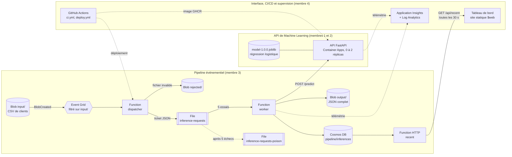

# Architecture du projet

Un fichier CSV de clients déposé dans Blob Storage est traité sans aucune action manuelle, jusqu'au tableau de bord.
Toutes les ressources sont dans un seul groupe de ressources, dans la région **France Central**.

## Schéma

## Parcours d'un fichier

1. Un CSV de 1 à 1 000 clients arrive dans `input/` ; Event Grid publie l'événement `BlobCreated` vers le `dispatcher`.
2. Le `dispatcher` vérifie l'extension, la taille, l'encodage UTF-8 et les 20 colonnes. Fichier invalide : copie dans
   `rejected/` avec le motif. Fichier valide : un ticket JSON est posé dans la file `inference-requests`.
3. Le `worker` prend le ticket, lit le CSV et appelle `POST /predict` (délai maximal, client HTTP réutilisé).
4. L'API, qui embarque le modèle du membre 1, renvoie une probabilité de départ et un niveau de risque par client.
5. Le `worker` écrit le JSON complet dans `output/` et un résumé dans Cosmos DB (identifiant = nom du fichier + ETag,
   écriture en upsert : un même message traité deux fois ne crée pas de doublon).
6. Le tableau de bord interroge `GET /api/recent` toutes les 30 s et affiche le nouveau fichier.

Si l'API est indisponible, le message est repris 5 fois (`maxDequeueCount = 5`), puis isolé dans
`inference-requests-poison` sans être perdu.

## Composants et responsables

| Composant | Service Azure | Responsable | Dossier |
|---|---|---|---|
| Modèle de churn | (entraîné en local) | Membre 1 | `model/` |
| API d'inférence | Container Apps (Consumption) + GHCR | Membre 2 | `api/` |
| `dispatcher`, `worker`, `recent` | Functions Flex Consumption (une seule application) | Membre 3 | `functions/`, `infra/pipeline/` |
| Stockage et file | Blob Storage + Storage Queue | Membre 3 | `infra/pipeline/` |
| Persistance | Cosmos DB for NoSQL, Free Tier | Membre 3 | `infra/pipeline/` |
| Tableau de bord | Site web statique (`$web`) | Membre 4 | `web/` |
| CI/CD | GitHub Actions | Membre 4 | `.github/workflows/` |
| Supervision | Application Insights + Log Analytics | Membre 4 | `infra/monitoring.sh`, `docs/kql/` |

Les formats échangés entre les composants sont définis dans [`contrats.md`](contrats.md).
